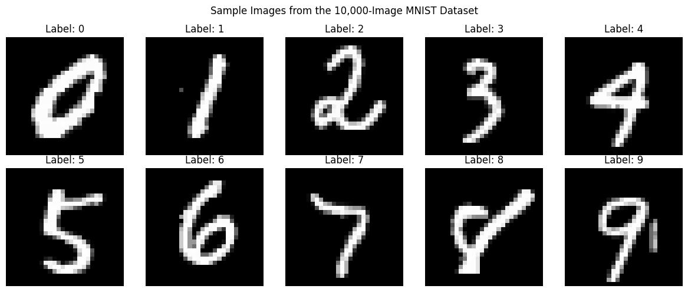
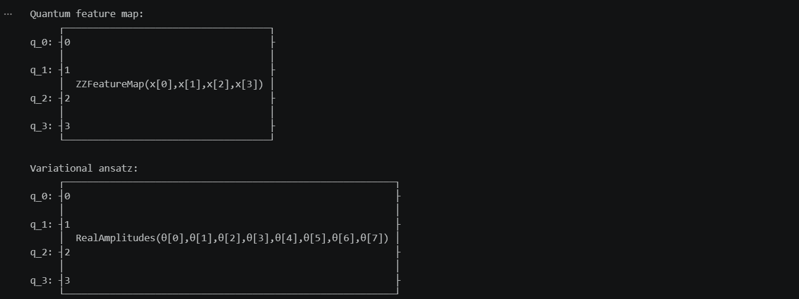
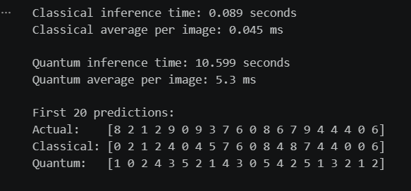
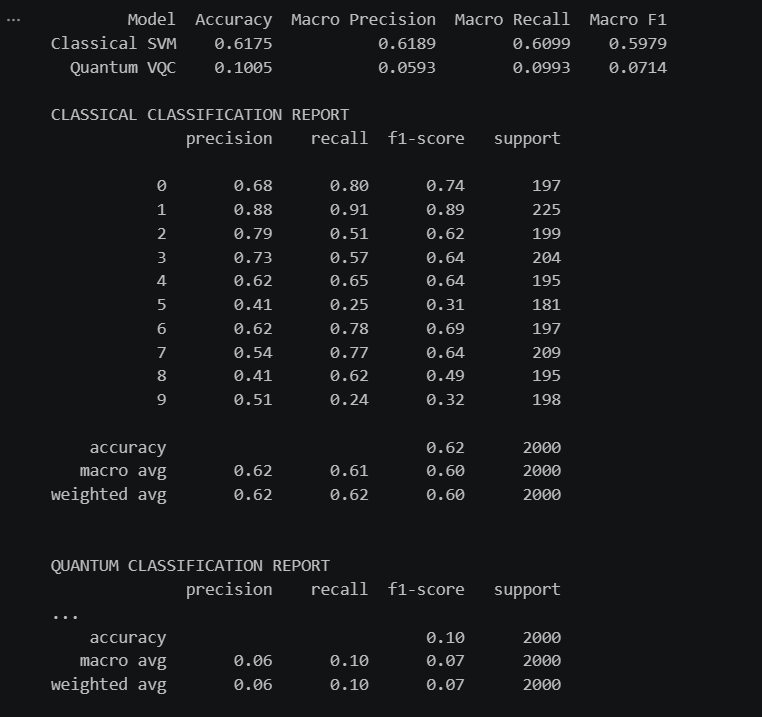
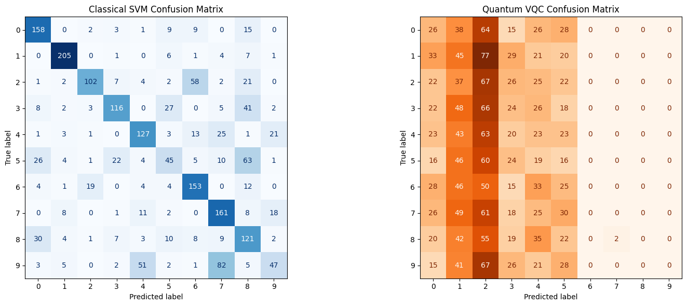
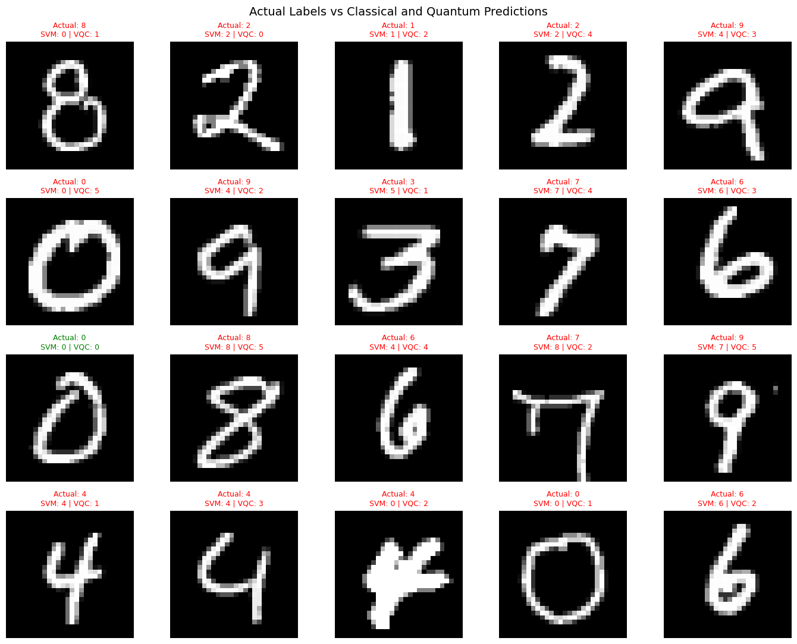
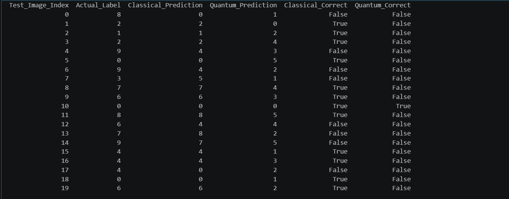

This project shows, comparison between classical and quantum machine learning in case of ten class handwritten digit recognition on a set of 10,000 images will be made. The dataset will be prepared by preprocessing and dimensionality reduction to four principal components via PCA algorithm. Then, classical SVM and quantum classifier (VQC) based on Qiskit will be trained to classify the MNIST dataset using classical computer and a quantum simulator, respectively. Both classifiers will be analyzed via such metrics as accuracy, precision, recall, F1, confusion matrix, time to train and to infer.

## 👩‍💻 Technologies Used
### Language: Python
### Tool: VS Code
### Classical Libraries
- TensorFlow / Keras
- Pandas, Matplotlib, NumPy, Scikit-Learn
### Quantum
- Qiskit
- Qiskit Machine Learning
- Qiskit Algorithms
- StatevectorSampler

### Installation
```
!pip install numpy matplotlib scikit-learn tensorflow qiskit qiskit-machine-learning qiskit-algorithms
```
### Output Images
<div>
  
  
  
  
  
  
  
</div>
